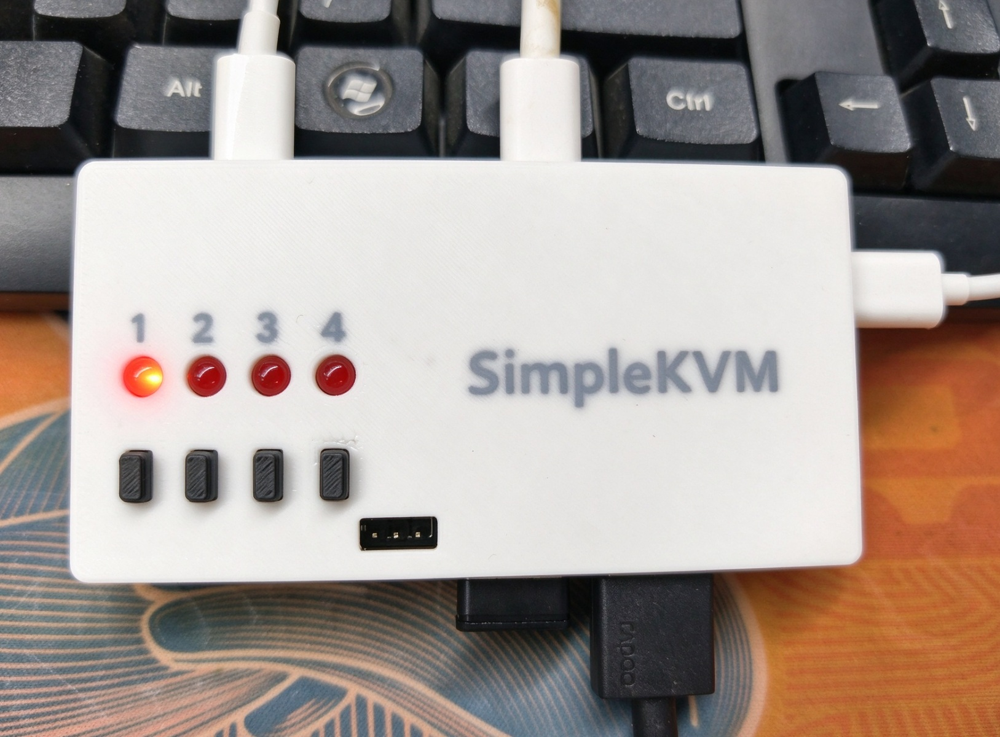
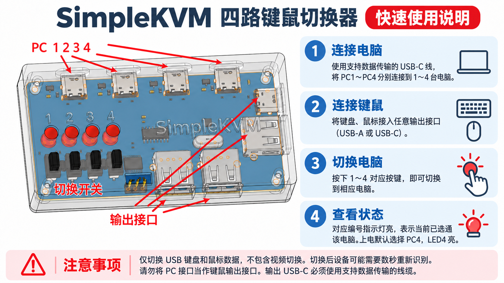

# SimpleKVM 四路 USB 键鼠切换器

SimpleKVM 是一个面向桌面场景的四电脑 USB 键盘鼠标切换器。四台电脑通过 USB-C 接入，设备从中选择一路连接到板载 USB Hub，再把键盘、鼠标或 USB 接收器连接到三个 USB-A 和一个 USB-C 输出口。



> 当前状态：功能样机 / 开源预发布。固件、嘉立创EDA专业版可编辑工程、原理图、BOM和外壳资料已经整理；尚未补齐Gerber、钻孔和贴片坐标，兼容性与批量一致性也未完成。请勿将本项目视为量产认证设计。

## 主要功能

- 4个电脑侧 USB-C 接口，按键选择其中一路。
- 3个 USB-A 和1个 USB-C 下游输出接口。
- 4个独立按键和4个通道指示灯。
- CH444G负责USB数据切换，CH334P负责四口Hub，CH32V003F4P6负责按键、指示灯和切换时序。
- v0.1.1固件上电默认选择PC4，LED4亮。
- 切换时先断开数据、改变选择位，再重新接通，减少瞬时跨通道连接。

本项目只切换USB键鼠数据，不包含HDMI、DP等视频切换。纯蓝牙键鼠不能直接连接；带USB接收器的2.4G或双模键鼠可以按普通USB设备使用。

## 快速使用



1. 使用支持数据传输的USB-C线，把PC1～PC4分别连接到电脑。
2. 把键盘、鼠标或USB接收器连接到任意输出口。
3. 按1～4号按键选择电脑；对应LED表示当前选择通道。
4. 电脑重新枚举USB设备可能需要数秒。

## 目录

| 目录 | 内容 |
| --- | --- |
| `硬件设计/` | 嘉立创EDA专业版工程、原理图PDF、BOM和硬件设计说明；历史连接清单用于追溯 |
| `软件设计/` | CH32V003固件源码、测试、构建工具和v0.1.1预编译文件 |
| `结构设计/` | SolidWorks文件、STL、3MF打印文件和外观渲染 |
| `产品资料/` | 实物图和一页快速使用说明 |
| `docs/` | 复刻说明、结构说明、发布文案、版本范围和发布检查清单 |
| `LICENSES/` | 硬件、软件、文档及第三方代码的许可说明 |

全包文件列表、大小和哈希见`MANIFEST.csv`，逐文件SHA-256见`SHA256SUMS.txt`。

## 硬件架构

```text
PC1～PC4 USB-C
   │ D+/D-
   ▼
CH444G 4选1 USB数据开关
   │
   ▼
CH334P USB 2.0 Hub
   ├─ USB-A × 3
   └─ USB-C × 1

PC1～PC4 VBUS → 各自PTC → 各自CH213K → SYS_5V
CH32V003 → CH444G选择/使能 + 4按键 + 4LED
```

关键器件：

| 功能 | 器件 |
| --- | --- |
| MCU | CH32V003F4P6 |
| USB数据4选1 | CH444G |
| USB Hub | CH334P |
| 四路电源防反灌 | CH213K × 4 |
| 输入保护 | 0603自恢复保险丝 × 4 |

数据链路的ESD器件在当前极简成本版中默认不装，只保留设计取舍记录；普通串联电阻不能替代ESD钳位。对外销售或复杂环境使用前应重新进行ESD、EMC和USB兼容性设计验证。

## 固件

首次完整功能验证建议烧录：

`软件设计/releases/v0.1.1/dev/simplekvm_dev.hex`

烧录器使用WCH-LinkE，目标选择CH32V003、RISC-V/SDI。目标板自行供电时只需连接SWIO、GND，NRST用于恢复；不要把下载器3.3V接到本板5V电源。

固件源码位于`软件设计/firmware/App`。构建与测试：

```powershell
cd 软件设计
python tools/bootstrap_tools.py
python tools/verify_hardware.py
python tests/test_behavior.py
python tools/build.py --profile all
```

本机路径配置`tools/local_config.json`不会进入开源包。WCH SDK文件保留原厂版权和“仅用于南京沁恒微电子MCU”的使用条件，详见[第三方说明](LICENSES/THIRD_PARTY_NOTICES.md)。

## 当前资料完整度

| 项目 | 状态 |
| --- | --- |
| 原理图PDF | 已提供2026-10-29版 |
| BOM | 已提供2026-10-29版XLSX |
| 同版本原理图网表 | **缺失**；历史连接清单仅用于追溯 |
| 固件源码与HEX | 已提供v0.1.1 |
| 外壳SolidWorks/STL/3MF | 已提供 |
| 嘉立创EDA专业版原理图/PCB工程 | 已提供`.epro2` |
| Gerber/钻孔/坐标文件 | **缺失** |
| STEP通用结构文件 | **缺失** |
| USB/ESD/EMC认证 | 未执行 |

可编辑工程位于`硬件设计/ProPrj_SimpleKVM_2026-10-29.epro2`，内部包含3页原理图和1块PCB。当前仍没有Gerber、NC Drill和贴片坐标，复刻者应先在嘉立创EDA专业版打开工程、检查DRC并重新导出生产文件，不要直接把原理图PDF当成可投板资料。

## 样机状态与已知问题

- 5块样机此前有3块异常，现均已修复并恢复功能。
- 已确认故障与回流焊后0603自恢复保险丝损坏、阻值异常有关；更换保险丝后故障消失。
- 自恢复保险丝正常情况下应能承受符合规格的回流焊。复刻时仍需核对准确料号、批次、峰值温度、液相线以上时间和重复回流次数，并在上电前逐个测量F1～F4冷态阻值，不能把本次结果简单理解为“所有PTC都不能回流焊”。
- v0.1.1已完成主机端23项逻辑测试和交叉编译，但仍需继续积累实板兼容性与长期运行结果。

## 许可证

本仓库采用分层许可，不能把所有文件统一理解为MIT：

- 自研固件应用、测试和构建脚本：MIT。
- 自研电子硬件和机械结构：CERN-OHL-P-2.0。
- 文档、图片和说明材料：CC BY-SA 4.0。
- WCH SDK及第三方元件模型：适用各自原有条款，不由本项目重新许可。

详见[LICENSE.md](LICENSE.md)和`LICENSES/`目录。

## 免责声明

本项目按“现状”提供，不附带适销性、特定用途适用性或安全性保证。USB主机端口、多路供电、外设短路、静电和错误焊接都可能损坏电脑或外设。复刻前请先使用限流电源完成短路、绝缘、电压、温升和反灌检查。

