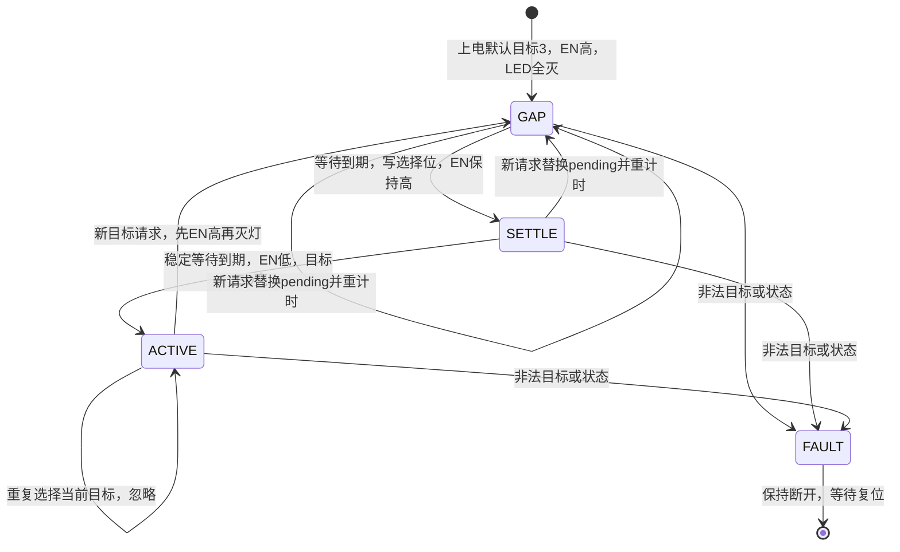

# 四电脑键鼠共享器软件方案

版本：S1.0，2026-10-21。硬件已投板，本文为固件开发依据。

> 实现进度：固件v0.1.1已按本方案编写；v0.1.0已完成首次烧录，v0.1.1将上电默认通道改为电脑4。源码与可烧录文件见[固件入口](README.md)，实际测试范围见[构建记录](03_测试与构建记录.md)。文中“拟建立/后续开发”保留为原设计描述，当前实现以源码和构建清单为准。

## 1. 硬件基线和开发范围

固件最初按2026-10-21下午已投板版本开发，当前发布包的硬件资料已更新为2026-10-29版：

- [当前原理图](../硬件设计/SCH_SCH_new_2026-10-29.pdf)
- [当前BOM](../硬件设计/BOM_SimpleKVM_new_SCH_new_2026-10-29.xlsx)
- [当前硬件资料说明](../硬件设计/README.md)
- [历史下午版硬件复查](../硬件设计/13_原理图复查_2026-10-21-2.md)

历史网表SHA-256为`b54f1f99c8de1449b985926847d8d976c1113d993f46d08a57aa5d76fe3327fa`，仅用于说明最初固件开发基线。当前目录没有10月29日同版本ENET网表，不能把历史自动检查结果当成当前工程的生产放行依据。

U8为CH32V003F4P6/TSSOP20，KEY1为CH444G，U6为CH334P。数据结构为“四台电脑选一台，再由Hub连接多个外设”。下游USB8 Type-C使用Hub第1路，USB5、USB6、USB7三个USB-A使用第2、3、4路。

MCU只负责按键、LED和CH444G控制。CH334P、外设和目标电脑自行完成USB通信与枚举；固件不实现USB主机、USB设备栈或HID解析。新增Type-C不增加软件初始化步骤。

当前板子没有主机VBUS检测、Type-C CC检测、下游电源控制、Hub复位控制和USB枚举状态输入。软件按现板开发，不假设存在这些接口，也不把改板作为本阶段前提。

## 2. 首版功能约定

| 场景 | 行为 |
| --- | --- |
| 正常上电/复位 | 默认选择电脑4；不记忆上次通道 |
| 按SW1～SW4 | 分别选择电脑1～4 |
| 按住按键 | 只触发一次；无长按功能、无连发 |
| 按键抖动 | 按下及释放均按20ms稳定时间确认 |
| 重复选择已接通的电脑 | 忽略，保持USB连接，不触发重新枚举 |
| 切换过程中又收到有效按键 | 最后一个有效请求生效，重新计算断开等待 |
| 多键按下 | 本次输入锁定，全部释放稳定20ms后恢复 |
| 按住某键上电 | 不把它当作指令；仍按默认电脑4启动，全部释放后才能接受按键 |
| 选择没接线或USB已断电的电脑 | 仍切到该通道，亮对应LED；不自动找其他电脑 |
| 目标电脑关机、休眠或掉线 | 固件无法感知，保持原选择 |
| LED | 通道接通时仅目标灯亮；切换等待及故障时全灭 |
| 固件升级 | 使用WCH-LinkE经H1烧录；首版不做串口IAP/USB升级 |

LED表示“已选中该数据通道”，不表示电脑在线或USB枚举成功。目标电脑的系统识别时间不计入MCU切换时序承诺。

上电默认电脑4、不保存目标是首版设计选择，不增加Flash擦写、配置恢复或额外用户设置。首版不做键盘热键、自动轮询、蓝牙配对和视频切换。

## 3. GPIO与信号极性

软件使用`target=0..3`表示电脑1～4；`TARGET_NONE=0xFF`表示无有效接通目标。GPIOC和板上“PC0”电脑编号不是同一概念。

| 信号 | GPIO | U8脚号 | 网表网络/去向 | 配置及有效电平 |
| --- | --- | --- | --- | --- |
| LED1 | PC0 | 10 | PC0_LED | 推挽，高灭、低亮 |
| LED2 | PC1 | 11 | PC1_LED | 推挽，高灭、低亮 |
| LED3 | PC2 | 12 | PC2_LED | 推挽，高灭、低亮 |
| LED4 | PC3 | 13 | PC3_LED | 推挽，高灭、低亮 |
| SW1 | PD3 | 20 | PC0_SWI | 内部上拉输入，按下为0 |
| SW2 | PD4 | 1 | PC1_SWI | 内部上拉输入，按下为0 |
| SW3 | PD5 | 2 | PC2_SWI | 内部上拉输入，按下为0 |
| SW4 | PD6 | 3 | PC3_SWI | 内部上拉输入，按下为0 |
| SEL0 | PC6 | 16 | MUX_SEL0→KEY1.14 IN0 | 推挽，初始0 |
| SEL1 | PC7 | 17 | MUX_SEL1→KEY1.2 IN1 | 推挽，初始0 |
| EN_N | PD2 | 19 | MUX_EN_N→KEY1.1 EN# | 推挽，初始1；高断开、低接通 |
| SWIO | PD1 | 18 | H1.1 | 保留SDI下载调试功能 |
| NRST | PD7 | 4 | H1.2 | 保留复位功能，不改为GPIO |

R1～R4默认不装，必须打开按键内部上拉。LED由R5～R8各4.7k限流，首版只开关、不做PWM。

| target | 外壳电脑编号 | SEL1/PC7 | SEL0/PC6 | 点亮 |
| --- | --- | --- | --- | --- |
| 0 | 电脑1 | 0 | 0 | LED1 |
| 1 | 电脑2 | 0 | 1 | LED2 |
| 2 | 电脑3 | 1 | 0 | LED3 |
| 3 | 电脑4 | 1 | 1 | LED4 |

LED和选择线共用GPIOC。只能按掩码操作：LED掩码为PC0～PC3，选择掩码为PC6/PC7；禁止整口写入覆盖另一组信号。建议用GPIO置位/复位寄存器，选择位可一次提交掩码。即便两位写入存在先后，也必须全程在EN#高电平时完成。

PA1、PA2、PD0、PC4、PC5未接功能电路，保持不驱动，并按芯片手册配置未用引脚。不得用整口初始化覆盖PD1调试、PD7复位或任何已用脚。不开启USART、SPI、I2C或定时器引脚复用。

## 4. 工具链、时钟和执行方式

采用MounRiver Studio、WCH官方CH32V003 SDK和裸机C，不使用RTOS、动态内存、文件系统或浮点输出。后续建立工程时固定SDK提交号、编译器版本、启动文件和链接脚本，保留WCH原始版权及使用条件。此阶段尚未导入SDK，不把浮动main分支当作发布版本。

MCU采用内部HSI 24MHz。板上的12MHz晶体属于CH334P，不是MCU外部时钟。官方示例的`system_ch32v00x.c`支持`SYSCLK_FREQ_24MHZ_HSI`，但所查示例默认启用了48MHz HSE配置；建工程时必须显式改为24MHz HSI，并检查启动过程和`SystemCoreClock`。不能只在main里改一个宏就认为启动时钟已经改变。[官方时钟配置源码](https://github.com/openwch/ch32v003/blob/main/EVT/EXAM/GPIO/GPIO_Toggle/User/system_ch32v00x.c)

使用TIM2产生1ms节拍，不映射到任何引脚。定时器实际时钟为24MHz时，PSC=23、ARR=999：`(23+1)×(999+1)/24000000=1ms`。开发时确认实际时钟树，变更主频后重新计算。中断只清标志、递增`volatile uint32_t g_ms`；按键、LED和切换状态机全部在主循环执行。

沿用SDK对应的启动及中断声明方式，确保`TIM2_IRQHandler`真正连接到向量表。官方中断例程使用TIM1，不能照搬其中的重复计数参数、5秒周期和串口打印。[官方定时器中断例程](https://github.com/openwch/ch32v003/blob/main/EVT/EXAM/TIM/TIM_INT/User/main.c)

主循环每遇到新的毫秒时刻，读一次当前按键并推进状态机，不用阻塞式延时，不伪造漏掉的历史采样。采用32位无符号时间差判断超时，正确处理约49.7天的毫秒计数回绕。

资源目标为Flash不超过8KB、静态RAM不超过512B，另核查栈余量；这是项目目标，最终以链接map和实际调用深度为准。移除SDK例程中的USART/SDI打印和`printf`，特别是USART会占用已接按键的PD5/PD6。

## 5. 上电和复位流程

1. 复位时R9把EN#上拉，硬件默认断开；R10/R11把选择位拉为00。
2. 启动文件完成必要初始化；使用HSI，不等待不存在的MCU外部晶体。核查`SystemInit`没有意外复用已用引脚。
3. 打开GPIO时钟，先把PD2输出锁存置1、PC0～PC3置1、PC6/PC7置0，再切为推挽输出，避免初始化低脉冲误接通。
4. 配置PD3～PD6内部上拉输入；LED全灭，EN#保持高。保留PD1与PD7。
5. 初始化TIM2；状态机置GAP，`pending_target=3`，`active_target=TARGET_NONE`。从这个时刻开始计算启动断开等待。
6. 按键模块初始为未解锁，必须全部释放稳定20ms后才能接收事件。启动期间出现新的合法请求，可以替换默认目标。
7. GAP到期后写选择位；再等待SETTLE，最后拉低EN#并点亮对应LED。

掉电或NRST复位后都重新默认电脑4。上电等待是固定样机参数，不表示软件检测到了Hub电源稳定。固件不执行灯光轮播，避免开机时误导通道状态。

## 6. 按键算法

每1ms读取PD3～PD6并转换为4位掩码，bit0～3对应SW1～SW4，1表示按下。使用整个掩码的稳定时间做消抖：原始值变化就重置候选和候选起始时间，连续20ms不变才采纳。

输入分为ARMED和WAIT_RELEASE两种状态：

- 启动、一次按下事件后，以及多键出现后，进入WAIT_RELEASE。
- 原始采样一旦出现两个或以上按键，立即进入WAIT_RELEASE，不等待多键稳定。
- WAIT_RELEASE只有在全部松开连续20ms后才回到ARMED；某键单独剩下按住不能产生新事件。
- ARMED下，一个按键稳定20ms，生成一次target事件，然后立即回到WAIT_RELEASE。
- 某键已经触发后再按另一个键，不产生第二个事件；第一条已经发出的切换不能事后撤回。
- 相邻有效采样间隔大于2ms，清除候选稳定计时；如有键按下则等待全释放。不能一次读取GPIO后循环补做20次采样。

主循环同一轮先处理按键事件，再推进切换状态机，避免旧目标恰好到期时先接通又立即断开。

## 7. USB通道切换状态机

状态为GAP、SETTLE、ACTIVE和FAULT。只有状态机可以改变EN#或选择位，ISR不操作这些输出。



| 参数 | S1.0设计值 | 用途 |
| --- | --- | --- |
| DEFAULT_TARGET | 3 | 每次上电选择电脑4 |
| KEY_DEBOUNCE_MS | 20 | 按下、全释放消抖 |
| KEY_SAMPLE_GAP_MAX_MS | 2 | 超过此间隔重建稳定采样 |
| BOOT_GAP_TICKS | 101 | 首次接通前的断开等待 |
| SWITCH_GAP_TICKS | 101 | 每次有效新请求后的断开等待 |
| MUX_SETTLE_TICKS | 2 | 写选择位后保持断开 |
| DEV看门狗 | 关闭 | 首次单步和引脚联调 |
| RELEASE看门狗 | 启用，目标约1秒 | 检测主循环/节拍停滞，需实测超时 |

时间参数较旧S0.1的100/1个tick增加了量化余量。在标称1ms节拍下，一次请求后约102～103ms接通，不含按键消抖和电脑重新枚举。101/2个tick不等于精密计时保证，HSI误差和调度误差仍要用波形测量；实际USB兼容性测试后可统一调整参数。

请求处理必须按下面顺序：

1. 校验target范围和当前状态；非法则先断开并进入FAULT。
2. 如果ACTIVE且target等于active，立即返回，不操作输出。
3. EN#置高，LED全灭，`active=TARGET_NONE`。
4. 保存`pending=target`，进入GAP并记录当前时间。
5. GAP到期时，在EN#高电平下写SEL1/SEL0，进入SETTLE并重新记时。
6. SETTLE到期时再校验状态，拉低EN#，`active=pending`，仅亮对应LED，进入ACTIVE。

GAP或SETTLE收到新请求都重走第3～4步，不短暂接通旧pending。等待使用`(uint32_t)(now-start) >= ticks`，每次只推进一个阶段；主循环落后时不能同轮连续越过GAP和SETTLE。

## 8. 模块和接口

拟建立下列工程结构；这些是后续开发文件，不是现阶段已经存在的固件源码。

```text
软件设计/
  01_软件方案.md
  firmware/
    App/main.c
    App/app_config.h
    App/board.h/.c
    App/timebase.h/.c
    App/key.h/.c
    App/switch_ctrl.h/.c
    App/health.h/.c
    Vendor/                 固定版本SDK、启动与芯片库
    Project/                MounRiver工程、链接及构建配置
  tests/                    可在电脑执行的行为测试
  releases/                 编译产物、map、版本及校验信息
```

| 模块 | 责任与主要接口 |
| --- | --- |
| board | `board_init_safe()`；`board_key_mask()`；`board_led_show(target)`；`board_mux_disable/select/enable()` |
| timebase | 初始化TIM2，返回毫秒快照；ISR只维护计时 |
| key | `key_init()`；`key_poll(mask, now)`，返回NONE或单个target |
| switch_ctrl | `switch_init(now)`；`switch_request(target, now)`；`switch_poll(now)` |
| health | 统一故障处理、开发/运行看门狗策略；保存RAM调试状态 |
| main | 安全初始化、主循环调度；唯一装配各模块的入口 |

模块不动态申请内存，不在中断打印，不在按键回调里等待USB枚举。board只暴露必要硬件能力，不增加虚构的USB供电开关、在线检测或枚举完成函数。

RAM调试信息至少包含版本号、state、active、pending、raw_key_mask、key_state、g_ms、切换计数、最后一次fault。通过调试器读取，不占用额外IO；Release也保留足够的定位信息，准确资源占用以map为准。

## 9. 异常和看门狗

非法目标、损坏的状态值或不满足接通条件时，立即拉高EN#、关闭全部LED，进入FAULT。DEV保持此状态供调试；RELEASE停止喂狗并等待看门狗复位。FAULT不允许普通按键绕过。

首个引脚验证固件使用DEV配置，避免断点引发重复复位。准备长期运行的RELEASE配置启用独立看门狗，目标超时约1秒；分频和重载值在固定SDK/手册下计算，并测量实际上下限，不照抄官方4秒例程。喂狗只在主循环内、看到新节拍且按键扫描与状态推进均完成、状态校验通过后执行，禁止ISR无条件喂狗。[官方独立看门狗例程](https://github.com/openwch/ch32v003/blob/main/EVT/EXAM/IWDG/IWDG/User/main.c)

若程序完全卡死，EN#可能维持复位前电平，直到看门狗复位；不能承诺软件卡死瞬间就断数据。复位后依靠R9回到断开，再按默认电脑4启动。重复看门狗复位可能造成反复USB重枚举，必须作为发布前故障测试。

无主机供电、过流和枚举反馈时，不把故障复位当作USB“自动恢复”功能。不进入深度睡眠，不关闭SDI或NRST，不做Flash目标记忆，不修改调试保护选项。

## 10. 烧录和首次上板

使用WCH-LinkE的RISC-V/SDI流程。H1脚序为1=SWIO、2=NRST、3=GND；本板通过正常USB或受控台架路径自供电。接线细节沿用[下载接口指南](../硬件设计/08_下载接口与烧录指南.md)。ST-Link、J-Link V8和普通USB-TTL不作为本工程直接烧录工具。

本板已经供电时，不连接下载器的5V/3V3电源输出；SWCLK不接。先进行器件连接和程序校验，再复位运行。不要烧改系统BOOT区、关闭调试口或使用未经核对的选择字设置。恢复连接优先使用H1的NRST。

第一轮上板分三步：

1. DEV：保持数据断开，先验证下载、四键输入与四灯极性，确认没有引脚冲突。
2. DEV：运行完整状态机，用逻辑分析仪验证EN#、SEL1、SEL0及按键对应，确认计时实际正确，再接入USB外设。
3. RELEASE：加入并验证看门狗；执行四台电脑与四个下游口的真实USB、掉电和长期切换测试。

首版不需要电脑配置软件。电脑接线、通道编号和重新识别USB的行为写入样板说明即可。

## 11. 测试和交付标准

| 编号 | 测试 | 必须观察到的结果 |
| --- | --- | --- |
| F01 | 正常上电及NRST | 初始断开、灯灭，等待后接电脑4，只亮LED4 |
| F02 | SW1～SW4依次按下 | 目标、选择位和LED与第3节表一致 |
| F03 | 当前目标重复按；长按10秒 | 不产生额外切换，不反复枚举 |
| F04 | 小于20ms孤立脉冲、抖动、临界稳定时间 | 不误触发；稳定单键才生成一次事件 |
| F05 | 多键、按住一键再按另一键 | 全释放稳定前不接受新事件；不选随机目标 |
| F06 | 按住SW2上电，再松开重按 | 启动仍默认4，松开后新按才切2 |
| F07 | GAP、SETTLE末端提交新请求 | 最后请求生效，旧pending不被短暂接通 |
| F08 | 无按键时越过0xFFFFFFFF计数回绕；等待中回绕 | 计时和按键逻辑继续正确，不需真实等49.7天 |
| F09 | 人为延迟主循环或调试断点恢复 | 不把一次采样补算为多次；恢复需重新稳定/释放 |
| F10 | 注入非法状态/target | EN#高、灯灭；DEV可调试，RELEASE进入看门狗恢复 |
| F11 | 停主循环但保留TIM中断；停止TIM节拍 | RELEASE均不能持续喂狗，最终复位到默认4 |
| H01 | 波形抓EN#、SEL0、SEL1、SYS_5V | 选择位只在EN#高时变化；记录断开和稳定时间；GPIO操作不串扰LED |
| H02 | 四台电脑全部12种有向切换，各先做10次 | 每次仅所选主机识别外设，记录枚举时间和失败次数 |
| H03 | 三个A口和一个C口同时接低功耗外设 | 四路可用；USB8使用合适的数据线，正反插均验证 |
| H04 | 固定主机/接收器组合长期循环至少1000次 | 不出现状态卡死或非目标通道连接；区分主机兼容与固件故障 |
| H05 | 供电主机退出、所选主机VBUS关闭、全部掉电重上电 | 如实记录供电和断电边界；全部掉电恢复默认4，不虚称已自动检测 |
| H06 | BIOS/UEFI、操作系统登录前、常用有线及无线接收器 | 记录具体主机和外设的兼容性，不仅检查LED |

F03～F10中的纯逻辑部分用可控时钟和虚拟硬件记录做电脑端行为测试，断言输出顺序、禁止短暂接通以及事件数量；不能只校验配置表等于自身。F11部分恢复行为与所有H项需要实板验证。没有固件或样板执行前，不将表格标成“已通过”。

开发依次交付：

1. 工程与安全GPIO：固定工具链、正确时钟、可重复构建，保持下载恢复能力。
2. 功能固件：按键消抖、LED、非阻塞切换、逻辑测试及DEV/RELEASE配置。
3. 可烧录发布包：源代码和工程、HEX/BIN、map、SDK提交号、编译命令/版本、文件SHA-256及测试记录。
4. 样板验收记录：下载校验、真实波形、主机/外设清单、USB识别和供电边界结果。

## 12. 与旧方案的变化

- 硬件基线锁定到已投板的2026-10-21下午版，纳入3A+1C接口分配，GPIO不变。
- 正常带电电脑间仍由按键直接选择，不为无VBUS检测设计虚构软件补丁。
- 切换等待由100/1个tick调整为101/2个tick，增加毫秒计数的量化余量，最终以上板波形为准。
- 看门狗从旧文档的首版统一关闭，明确为DEV关闭、RELEASE启用并验证；不在ISR喂狗。
- 本文替代硬件目录中的S0.1软件草案，后续固件以本文为开发依据；功能增加或参数调整需要同步更新版本和验收记录。
